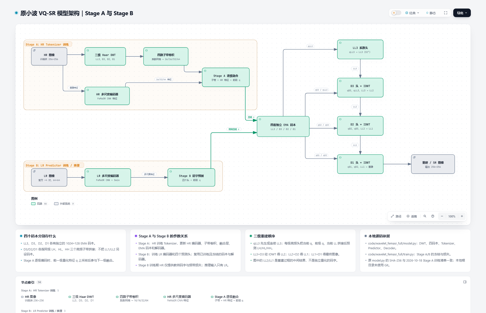

# Wavelet VQ-SR：原版三级小波码本超分模型

这是 2026-10-18 完整训练实验所用的**原小波模型版本**。输入为官方 bicubic ×4 LR/HR 配对图像；Stage A 学习 HR 的三级 Haar 小波离散表示与重建，Stage B 从 LR 预测码本表示，经冻结的 Stage A 解码器和三级 IDWT 生成 SR。本仓库只公开代码、说明和架构图，不包含数据集或训练权重。



[打开可交互架构图](docs/architecture/original-wavelet.html)（下载 HTML 后在浏览器中打开）

## 结构与训练

- Stage A：HR → 三层 DWT → LL3、D3、D2、D1 四支编码 → 四个独立的 1024×128 EMA 码本 → 系数解码 → 三层 IDWT → 重建 HR。D3/D2/D1 分别含 LH、HL、HH。量化对象是编码后的特征向量，并非原始小波系数。
- Stage B：LR → FeMaSR 多尺度编码骨干和 Swin 上下文模块 → 四组预测特征 → 冻结码本及 Stage A 解码器 → 三级 IDWT → SR。Stage A 教师及其解码器冻结；HR 只在训练时提供监督，推理只使用 LR。
- Stage A 训练 60,000 次更新，Stage B 训练 100,000 次更新；HR 256×256、LR 64×64、batch 8、seed 0。训练集为 DIV2K 800 对与 Flickr2K 2650 对；验证集为 DIV2K 100 对。没有使用 GAN。

这不是 SIT 作者代码的复现，也没有 VAR 自回归生成流程。模型借鉴小波离散表示并使用 FeMaSR 的编码组件。

## 依赖与准备

建议使用 Linux、CUDA GPU、兼容的 PyTorch/torchvision 环境。另需 `numpy`、`Pillow`、`scikit-image`、`lpips`，完整评估再安装 `DISTS-pytorch` 和 `pyiqa`。FeMaSR 原始仓库依赖也需满足，尤其 `einops`、`opencv-python` 等。具体版本按 GPU/CUDA 环境选择；本仓库不提供已验证的通用锁文件。

在本仓库根目录执行：

```bash
git clone https://github.com/chaofengc/FeMaSR.git FeMaSR_work
git -C FeMaSR_work checkout 1ca4295a2430057407f32d0d3fba70270ca68ce7
cp patches/basicsr_init_minimal.py FeMaSR_work/basicsr/__init__.py
cp patches/femasr_arch_stable.py FeMaSR_work/basicsr/archs/femasr_arch.py
export PYTHONPATH="$PWD/FeMaSR_work:$PWD/wavelet_femasr_full${PYTHONPATH:+:$PYTHONPATH}"
python wavelet_femasr_full/smoke.py
```

`patches/femasr_arch_stable.py` 是针对本轮从随机初始化训练的 FeMaSR 适配文件；它与作者原仓库的训练配方不同。`patches/basicsr_init_minimal.py` 仅替换包初始化方式，避免导入未用的训练栈。FeMaSR 来源与许可见下文。

## 官方数据目录

```text
data/
├── DIV2K_train_HR/*.png
├── DIV2K_train_LR_bicubic/X4/*x4.png
├── DIV2K_valid_HR/*.png
├── DIV2K_valid_LR_bicubic/X4/*x4.png
└── Flickr2K/
    ├── Flickr2K_HR/*.png
    └── Flickr2K_LR_bicubic/X4/*x4.png
```

读取器直接使用数据集发布方的 LR，不自行合成退化。`--data` 指向上面的 `data/`。训练命令如下（先完成 Stage A，再将其 60k 检查点传给 Stage B）：

```bash
python wavelet_femasr_full/train.py --variant wavelet --stage a \
  --data data --out runs/wavelet_a --steps 60000 \
  --microbatch 8 --accumulation 1 --workers 4 --cpu-threads 4 \
  --val-every 5000 --log-every 250 --seed 0

python wavelet_femasr_full/train.py --variant wavelet --stage b \
  --data data --out runs/wavelet_b --teacher runs/wavelet_a/step_060000.pt \
  --steps 100000 --microbatch 8 --accumulation 1 --workers 4 \
  --cpu-threads 4 --val-every 5000 --log-every 250 --seed 0
```

检查点实际文件名由 `train.py` 生成；运行 Stage B 前请核对 Stage A 输出目录。完整图评估脚本为 `wavelet_femasr_full/eval_full.py`，需要 `--variant wavelet --model <Stage B 检查点> --teacher <Stage A 检查点> --data data --out <结果目录>`。

## 本轮结果与边界

| DIV2K 验证集 100 张完整图，PSNR-Y | 本模型 | 同步数 FeMaSR B0 架构基线 |
|---|---:|---:|
| Stage B ×4 SR | 27.2807 dB | 30.0794 dB |

本轮模型**未超过**同步数的 FeMaSR B0。Stage A 的 HR 重建较强，但这一优势没有延续到 Stage B 的 LR→SR。B0 同样使用本轮训练协议，并带有稳定训练适配；该结果不是作者论文原始训练配方的完整复现，也不能单独证明或否定小波与码本结合的研究方向。

## 文件与来源

- `wavelet_femasr_full/`：本轮模型、官方配对数据读取、训练、可视化、评估和 GPU 冒烟检查。
- `patches/`：FeMaSR 骨干的稳定训练适配与轻量包初始化。训练清单中的 `femasr_arch.py` SHA-256 为 `6ae21eface1ebc1639fae84ab04512de9e104fc7ceb6a40dbda254e09b06bcc5`，与本仓库适配文件一致。
- `docs/architecture/`：原版模型的静态预览与 Archify 交互架构图。
- `third_party/FeMaSR_LICENSE.txt`：FeMaSR 上游许可。FeMaSR 原仓库为 [chaofengc/FeMaSR](https://github.com/chaofengc/FeMaSR)，本轮基于提交 `1ca4295a2430057407f32d0d3fba70270ca68ce7`。修改自其代码的文件仍须遵守原有 CC BY-NC-SA 4.0 条款；请在使用前查看许可全文。

